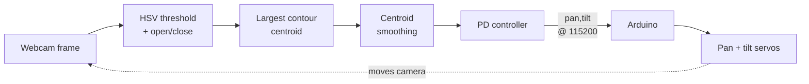

# Pan-Tilt PD Vision Tracker


A two-axis servo turret that keeps a coloured object centred in a webcam's view. OpenCV finds the
object by HSV colour, a PD controller turns the pixel error into servo angles, and an Arduino moves
the pan and tilt servos over serial.

## How it works



1. **Segmentation.** Each frame is converted to HSV and thresholded with the slider values. A
   morphological open then close removes speckle and fills holes. Red wraps around the ends of the
   hue scale, so it uses a second hue band.
2. **Target.** The largest contour above 500 px² is the target. Its centroid is smoothed with an
   exponential moving average so sensor noise does not reach the servos.
3. **Control.** The error is the distance from the centroid to the frame centre. Each axis gets

   ```
   Δangle = angle_smooth · (Kp · error + Kd · (error − previous_error))
   ```

   The derivative term damps overshoot that a P-only loop shows on a hobby servo. A 25 px deadzone
   stops the turret hunting around the centre, and the derivative is zeroed on the first frame
   after a target appears so re-acquisition does not kick the servos.
4. **Actuation.** Angles are clamped to 0–180° and sent only when they change.

## Project layout

| Path | Purpose |
|---|---|
| `tracker_app.py` | Camera loop, HSV tuning GUI (Tkinter), on-screen overlay |
| `pd_controller.py` | PD control law, no hardware dependencies |
| `serial_bridge.py` | Port auto-detection and the serial protocol |
| `test_pd_controller.py` | Controller checks, runnable without hardware |
| `firmware/pan_tilt_controller/` | Arduino sketch for the turret |
| `diagnostics/servo_cli.py` | Move the servos by hand to check wiring and range |

## Hardware

- Arduino Uno or compatible
- 2 × hobby servos (SG90 / MG90S) on a pan-tilt bracket
- USB webcam mounted on the bracket
- External 5 V supply for the servos, with ground shared with the Arduino

| Signal | Arduino pin |
|---|---|
| Pan servo | D9 |
| Tilt servo | D10 |

If your servos are wired to other pins, change `PAN_PIN` and `TILT_PIN` at the top of the sketch.

## Installation

```bash
git clone https://github.com/10yukine/pan-tilt-pd-vision-tracker.git
cd pan-tilt-pd-vision-tracker
python -m venv .venv
.venv\Scripts\activate        # macOS/Linux: source .venv/bin/activate
pip install -r requirements.txt
```

Then open `firmware/pan_tilt_controller/pan_tilt_controller.ino` in the Arduino IDE and upload it.

## Usage

```bash
python tracker_app.py
```

| Option | Meaning |
|---|---|
| `--camera N` | Webcam index (default 0) |
| `--port COM3` | Serial port. Auto-detected if omitted |
| `--invert-pan`, `--invert-tilt` | Flip an axis if the turret moves away from the target |

Pick a colour preset or tune the HSV sliders until only the target is white in the mask view, then
press **Start Following**. Press `q` in the video window to quit. With no board attached the app
still runs as a preview, which is useful for tuning the colour mask.

### Tuning

- Turret oscillates: lower the Kp sliders, or raise `kd` in `pd_controller.py`.
- Turret lags: raise Kp or `angle_smooth`.
- Turret jitters when centred: raise `deadzone`.

### Diagnostics

```bash
python -m diagnostics.servo_cli              # type "90 30", "s" to sweep, "h" for home
```

### Tests

```bash
python test_pd_controller.py
```

## Serial protocol

One ASCII line per update at 115200 baud: `pan,tilt\n`, both in whole degrees from 0 to 180.
Malformed lines are ignored by the firmware.

## Acknowledgements

Built together with **Gwen Alyzza M. Peregrino**.

## License

MIT
